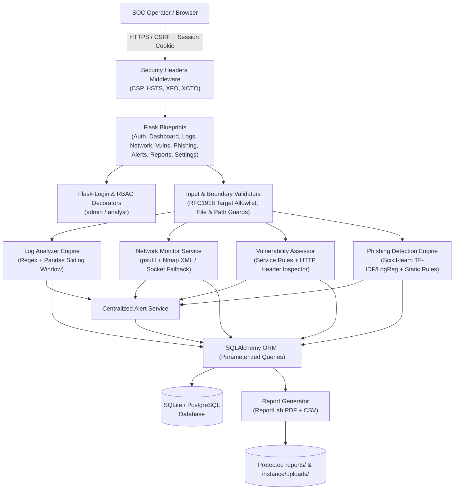
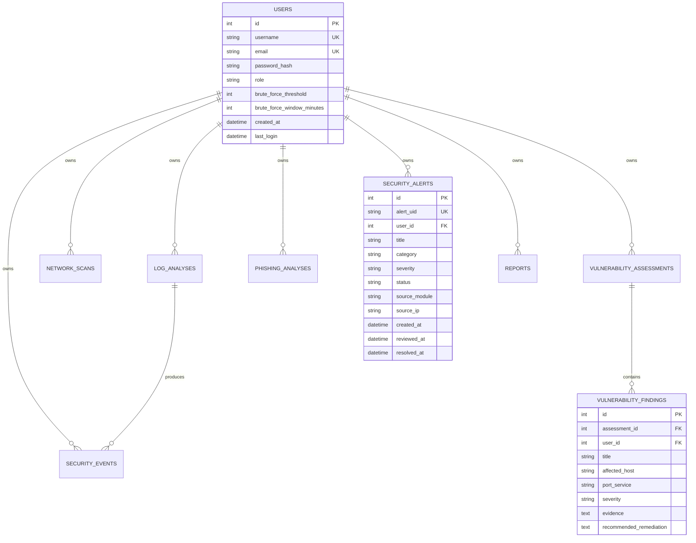
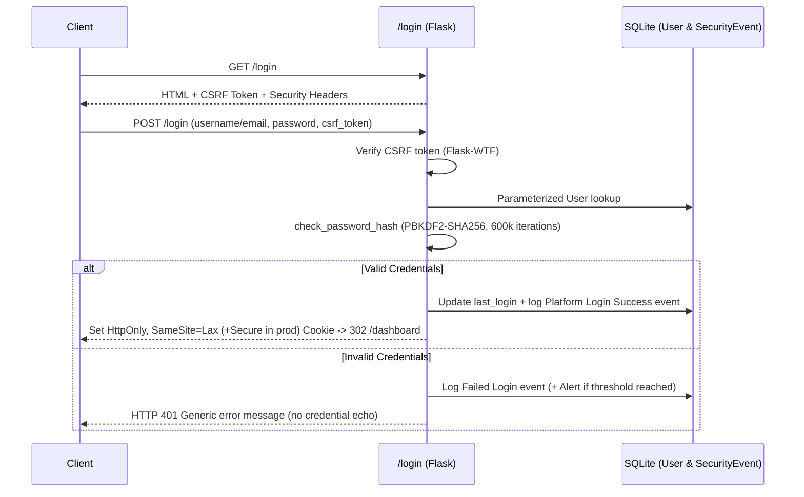

# NEXORA — Security Architecture Document

**Platform:** NEXORA — Cybersecurity Threat Monitoring & Vulnerability Assessment Platform  
**Version:** 1.0.0  
**Document Purpose:** Technical reference detailing system architecture, data flows, database design, authentication, security controls, trust boundaries, and threat mitigation.

---

## 1. System Architecture Overview

NEXORA follows a modular, layered Flask web architecture separating presentation (Jinja2/Bootstrap SOC UI), routing/access control (Flask Blueprints), cybersecurity analysis engines (`app/services/`), security enforcement (`app/security/`), and persistence (`app/models/` via SQLAlchemy ORM).

---

## 2. Component Descriptions

| Component | Path | Responsibility |
| --- | --- | --- |
| **Application Factory** | `app/__init__.py` | Wires config, extensions, blueprints, error handlers, security headers, and DB initialization. |
| **Security Validators** | `app/security/validators.py` | Enforces username/email/password rules, RFC1918/localhost target allowlisting, bounded port specs, file extension/size/binary checks, and path-traversal validation. |
| **RBAC Decorators** | `app/security/decorators.py` | Restricts privileged administrative actions (`admin` role) while permitting `analyst` operations. |
| **Security Headers** | `app/security/headers.py` | Applies `CSP`, `X-Content-Type-Options`, `X-Frame-Options`, `Referrer-Policy`, `Permissions-Policy`, and production `HSTS`. |
| **Log Analyzer** | `app/services/log_analyzer.py` | Passively parses `.log`, `.txt`, and `.csv` telemetry, performs sliding-window brute-force detection, aggregates suspicious IPs, and emits structured events/alerts. |
| **Network Monitor** | `app/services/network_monitor.py` | Enumerates local host interfaces/sockets via `psutil`, detects Nmap, executes Nmap safely (`shell=False`, `-oX -`), and falls back to bounded TCP socket probing when Nmap is unavailable. |
| **Vulnerability Assessor** | `app/services/vuln_assessor.py` | Evaluates discovered open services using transparent risk rules and non-intrusive HTTP security header checks without fabricating CVEs. |
| **Phishing Detector** | `app/services/phishing_detector.py` | Executes static lexical/structural inspection and Scikit-learn TF-IDF + Logistic Regression classification without making outbound requests to submitted URLs. |
| **Alert Service** | `app/services/alert_service.py` | Creates centralized alerts with unique `NEX-YYYYMMDD-XXXXXX` identifiers and manages `Open → Reviewed → Resolved` state transitions. |
| **Report Service** | `app/services/report_service.py` | Compiles live database telemetry into branded ReportLab PDF documents and structured CSV files. |

---

## 3. Data Flow Architecture

1. **Log Analysis Flow:** User uploads `.log`/`.txt`/`.csv` → `validate_log_upload()` checks extension, non-empty size (≤5 MB), and binary/null headers → `build_safe_upload_name()` + `is_safe_path()` prevent traversal → `analyze_log_content()` parses passively in memory → `LogAnalysis`, `SecurityEvent`, and triggered `SecurityAlert` rows are persisted atomically via SQLAlchemy.
2. **Authorized Scanning & Vulnerability Flow:** User submits target + port range + mandatory confirmation checkbox → `validate_authorized_target()` blocks public IPs, external domains, CIDR sweeps, and shell metacharacters → `subprocess.run([nmap_bin, ...], shell=False)` (or socket fallback) enumerates ports → XML parsed safely → `evaluate_discovered_services()` applies transparent rules & optional authorized HTTP header checks → `NetworkScan` / `VulnerabilityAssessment` / `VulnerabilityFinding` / `SecurityAlert` persisted.
3. **Phishing Analysis Flow:** User submits sender, subject, body, and URLs → static extraction via `re` and `urllib.parse` (zero DNS/HTTP requests) → rule-based scoring + Scikit-learn pipeline probability → `PhishingAnalysis`, `SecurityEvent`, and (for Suspicious/High Risk) `SecurityAlert` persisted.
4. **Reporting Flow:** User chooses report scope & format → `generate_security_report()` queries user-scoped (or admin-wide) live database records → writes PDF/CSV inside `reports/` → download verifies ownership and `is_safe_path()`.

---

## 4. Database Entity-Relationship Architecture

---

## 5. Authentication & Session Security Flow

---

## 6. Security Controls Matrix

| Control Category | Implementation Detail |
| --- | --- |
| **Password Security** | Werkzeug `pbkdf2:sha256:600000` salted hashing; minimum 8 chars with letter + digit policy; plaintext never logged or stored. |
| **CSRF Protection** | Global `Flask-WTF` `CSRFProtect` enabled across all POST forms and validated in development/production configs. |
| **SQL Injection Prevention** | Strict SQLAlchemy 2.x ORM parameterized queries everywhere; zero string-interpolated SQL statements. |
| **XSS Defense** | Jinja2 auto-escaping enabled by default across all HTML templates + restrictive `Content-Security-Policy` header + ReportLab XML escaping. |
| **Command Injection Prevention** | Nmap executed exclusively via argument list with `subprocess.run(..., shell=False)` after strict IP/port regex & `ipaddress` validation. |
| **SSRF / Unauthorized Scanning Prevention** | `validate_authorized_target()` restricts targets exclusively to loopback (`127.0.0.1`, `::1`, `localhost`) and single RFC1918 private IPs (`10/8`, `172.16/12`, `192.168/16`), rejecting public IPs, external hostnames, link-local metadata IP (`169.254.169.254`), and CIDR blocks. |
| **Upload & Path Traversal Protection** | Allowlisted extensions (`.log`, `.txt`, `.csv`), 5 MB size cap, null-byte & `MZ`/`ELF` executable rejection, UUID-prefixed `secure_filename()`, and `Path.resolve()` containment checks (`is_safe_path`). |
| **Authorization & Tenancy** | `login_required` on all operational routes; per-user ownership checks (`403 Forbidden`) on logs, scans, assessments, alerts, and reports; `role_required("admin")` for RBAC management. |
| **Safe Error Handling** | Custom `400`, `403`, `404`, `413`, and `500` error pages that suppress stack traces and internal paths; automatic DB session rollback on 500 errors. |
| **Secret Management** | Environment-driven `SECRET_KEY` and `DATABASE_URL` loaded via `python-dotenv`; `.env` excluded in `.gitignore`. |

---

## 7. Trust Boundaries & STRIDE Threat Model

### Trust Boundaries
1. **Browser ↔ Web Server (TB-1):** Untrusted user inputs (credentials, log files, email text, target IPs, query parameters) cross into Flask routes.
2. **Application ↔ Local OS / Nmap Subprocess (TB-2):** Validated scan parameters cross to Nmap or local socket APIs.
3. **Application ↔ Filesystem & Database (TB-3):** Uploaded logs, generated reports, and SQLite persistence.

### STRIDE Mitigation Summary

| Threat (STRIDE) | Potential Attack Vector | NEXORA Mitigation |
| --- | --- | --- |
| **Spoofing** | Credential stuffing, session hijacking, CSRF login/state forgery | PBKDF2-SHA256 hashing, `HttpOnly`/`SameSite=Lax`/`Secure` cookies, strong `Flask-Login` session protection, CSRF tokens, failed-login alerting. |
| **Tampering** | Path traversal on uploads/downloads, SQLi in alert search, unauthorized alert status modification | `is_safe_path()` containment, SQLAlchemy parameterized filters, per-user ownership & RBAC checks. |
| **Repudiation** | Unattributed scans or alert status changes | Timestamped `SecurityEvent`, `NetworkScan`, `VulnerabilityAssessment`, and `SecurityAlert` (`reviewed_by_id`, `reviewed_at`, `resolved_at`) audit trails. |
| **Information Disclosure** | Stack trace leaks, cross-user report access, verbose error messages, leaked secrets | Custom sanitized error templates, strict ownership checks on download/detail endpoints, `.env` gitignore exclusion, `X-Frame-Options: DENY`. |
| **Denial of Service** | Huge file uploads, sweeping 65,535 ports across CIDR subnets | `MAX_CONTENT_LENGTH=5MB`, single-host scan enforcement, max 100 ports per scan, 45-second Nmap subprocess timeout. |
| **Elevation of Privilege** | Analyst accessing admin role management, executing uploaded scripts or malicious phishing URLs | `@role_required("admin")` decorator, passive non-executing log ingestion, zero outbound network fetches in phishing analyzer. |
